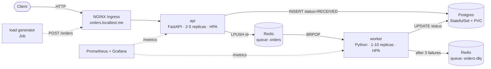

# aurora-orders

Asynchronous order-processing platform running on Kubernetes, with all infrastructure defined in Terraform. One command brings it up from scratch on a laptop, with no cloud account required.

> **Fictional scenario built for learning and demonstration.** Aurora Market is a made-up online store. This repository shows, end to end, how to design, provision, operate and troubleshoot a small but realistic distributed system.

   

---

## The problem

Aurora Market gets order spikes during promotions. The legacy system processed each order inside the HTTP request (check stock, calculate shipping, issue invoice). Under load the API stalled and customers got 504 errors.

**Solution:** decouple order intake from order processing.

- The **API** only validates the order, stores it as `RECEIVED` and pushes its ID to a queue. It responds in milliseconds.
- **Workers** consume the queue at their own pace and update the status to `PROCESSED` or `FAILED`.
- During spikes, Kubernetes **scales the workers** automatically. The queue absorbs the burst and nothing is lost.

## Architecture



### Components

| Component | Stack | Kubernetes object | Responsibility |
| --- | --- | --- | --- |
| `api` | Python 3.12, FastAPI, Pydantic, SQLAlchemy | Deployment + Service + HPA | Accepts and queries orders; publishes to the queue |
| `worker` | Python 3.12, redis-py | Deployment + HPA | Consumes the queue, processes, retries, sends to DLQ |
| `postgres` | Postgres 16 | StatefulSet + headless Service + PVC | Source of truth for orders |
| `redis` | Redis 7 | Deployment + Service | Work queue and dead-letter queue |
| `loadgen` | Python, httpx (async) | Job | Generates N orders per second for load tests |
| Observability | kube-prometheus-stack | Helm release | Metrics, dashboards and alerts |

### Order lifecycle

```text
RECEIVED ──► PROCESSING ──► PROCESSED
                 │
                 └──(error)──► retry (up to 3x) ──► FAILED  →  id moved to orders-dlq
```

## API

| Method | Route | Description |
| --- | --- | --- |
| `POST` | `/orders` | Creates an order. Returns `202 Accepted` with the `id` |
| `GET` | `/orders/{id}` | Returns status and details |
| `GET` | `/orders?status=FAILED` | Lists orders by status |
| `GET` | `/healthz` | Liveness: the process is alive |
| `GET` | `/readyz` | Readiness: Postgres and Redis are reachable |
| `GET` | `/metrics` | Prometheus metrics |

Example:

```bash
curl -s -X POST http://orders.localtest.me/orders \
  -H 'Content-Type: application/json' \
  -d '{"customer": "maria", "items": [{"sku": "COFFEE-500G", "qty": 2}], "zip": "01001-000"}'
# {"id": "8f3c...", "status": "RECEIVED"}
```

## The Python side

The application code is intentionally small (about 250 lines in total), but written the way production services should be:

- **Typed and validated:** Pydantic models for every request and response; `mypy --strict` in CI.
- **Idempotent worker:** status transitions use `UPDATE ... WHERE status = 'RECEIVED'`, so a message delivered twice is processed once.
- **Graceful shutdown:** the worker traps `SIGTERM`, finishes the current order and exits before Kubernetes sends `SIGKILL`, so rolling updates never drop work.
- **Separate health semantics:** `/healthz` checks only the process; `/readyz` checks dependencies (see ADR-004).
- **Instrumented:** `prometheus-client` exposes business metrics (`orders_received_total`, `orders_processed_total`, `queue_depth`, `processing_seconds`).
- **Tested:** `pytest` unit tests, plus integration tests that spin up Postgres and Redis with `testcontainers`.
- **Small, secure images:** multi-stage Dockerfiles on `python:3.12-slim`, non-root user, dependencies managed with `uv`.

## Repository layout

```text
aurora-orders/
├── app/
│   ├── api/                  # FastAPI service, Dockerfile, tests
│   ├── worker/               # queue consumer, Dockerfile, tests
│   └── loadgen/              # load generator
├── infra/                    # Terraform
│   ├── modules/
│   │   └── kind-cluster/     # reusable cluster module
│   ├── 01-cluster/           # layer 1: kind cluster (own state)
│   └── 02-platform/          # layer 2: ingress, metrics-server, Prometheus, Argo CD
├── deploy/
│   ├── charts/aurora/        # Helm chart for the app (api, worker, postgres, redis)
│   └── envs/
│       ├── dev-values.yaml
│       └── stg-values.yaml
├── policies/                 # NetworkPolicies, ResourceQuota, LimitRange
├── docs/
│   ├── adr/                  # architecture decision records
│   └── runbooks/             # what to do in each incident
├── .github/workflows/ci.yaml
├── Makefile
└── README.md
```

## Getting started

### Prerequisites

Linux or Windows with WSL2 (Ubuntu), 8 GB of free RAM, and: Docker, kubectl, kind, Helm, Terraform ≥ 1.9.

### Bring everything up

```bash
git clone https://github.com/luizceniz/aurora-orders.git
cd aurora-orders
make up        # minio → cluster → platform → build images → deploy app
```

After about 8 minutes:

| URL | What |
| --- | --- |
| http://orders.localtest.me/docs | API Swagger UI |
| http://grafana.localtest.me | Dashboards (user `admin`, password via `make grafana-password`) |
| http://argocd.localtest.me | Argo CD syncing `deploy/` |
| http://localhost:9001 | MinIO console (Terraform state) |

### Day-to-day commands

```bash
make load RPS=50 DURATION=120   # run the load generator
make status                     # orders by status, queue depth, current replicas
make logs SVC=worker            # aggregated logs
make test                       # Python tests + terraform test
make down                       # destroy everything (state stays in MinIO)
```

## What this project demonstrates

| Skill | Where to look |
| --- | --- |
| Layered infrastructure as code with remote state and locking | `infra/`, S3 backend on MinIO with `use_lockfile` |
| Reusable, tested Terraform modules | `infra/modules/kind-cluster/` + `tests/*.tftest.hcl` |
| Queue-based decoupling and idempotent processing | `app/worker/`, ADR-002 |
| Horizontal autoscaling under real load | api and worker HPAs, `make load` |
| Stateful workloads on Kubernetes | Postgres StatefulSet + PVC |
| Correct health checks (liveness ≠ readiness) | `/healthz` and `/readyz`, ADR-004 |
| Zero-downtime rollouts | `SIGTERM` handling + `terminationGracePeriodSeconds` |
| Network security by default | `policies/` with deny-all + explicit allows |
| Multi-tenancy with limits | ResourceQuota and LimitRange per namespace |
| Packaging and environments | Helm chart + per-environment values |
| GitOps | Argo CD applies `deploy/` on every commit to `main` |
| Infrastructure CI | fmt, validate, tflint, trivy, kubeconform, pytest, mypy |
| Observability | Business metrics in Grafana: orders/s, latency, queue depth, DLQ |
| Operations and troubleshooting | `docs/runbooks/` with incidents triggered on purpose and resolved |

## Architecture decision records

| ADR | Decision | Rejected alternative |
| --- | --- | --- |
| [001](docs/adr/001-kind-local.md) | kind for local, zero-cost runs | minikube (less faithful multi-node setup) |
| [002](docs/adr/002-redis-as-queue.md) | Redis list (`LPUSH`/`BRPOP`) as the queue | RabbitMQ/Kafka: more robust, unnecessary complexity here |
| [003](docs/adr/003-layered-terraform.md) | Cluster and platform in separate states | Single state: kubernetes provider fails at `plan` without a cluster |
| [004](docs/adr/004-probes.md) | Liveness does not check dependencies | Liveness checking the DB: cascading restarts |
| [005](docs/adr/005-gitops-for-apps.md) | Terraform up to the platform; apps via Argo CD | App `helm_release` in Terraform: slow, coupled deploys |

## Runbooks

Each runbook was written after triggering the failure on purpose.

| Incident | Symptom | Runbook |
| --- | --- | --- |
| Queue keeps growing | `queue_depth` rising, workers at max replicas | [queue-backlog.md](docs/runbooks/queue-backlog.md) |
| Orders landing in the DLQ | `DLQNotEmpty` alert | [dlq.md](docs/runbooks/dlq.md) |
| Postgres node lost | API `/readyz` failing, pod `Pending` | [postgres-node-lost.md](docs/runbooks/postgres-node-lost.md) |
| Drift between Terraform and the cluster | Unexpected changes in `terraform plan` | [drift.md](docs/runbooks/drift.md) |
| Stuck state lock | `Error acquiring the state lock` | [state-lock.md](docs/runbooks/state-lock.md) |

## Load test results

Fill in with your own numbers after running `make load`:

| Scenario | Orders/s | Worker replicas | API p95 | Time to drain the queue |
| --- | --- | --- | --- | --- |
| Baseline | 10 | 1 | _ ms | _ s |
| Spike | 100 | _ | _ ms | _ s |
| Spike without HPA | 100 | 1 | _ ms | _ s |

## Roadmap

- [ ] Scale workers on queue depth with KEDA instead of CPU
- [ ] Migrate from Ingress to Gateway API
- [ ] Secrets via External Secrets Operator
- [ ] Run the same Terraform on EKS by swapping only layer 1
- [ ] Distributed tracing with OpenTelemetry from API to worker

## License

MIT
